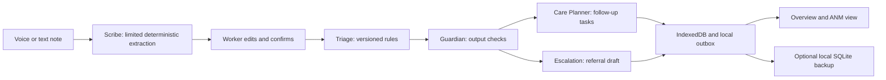

# ASHA Sahayak

A voice-first community-care workspace for ASHA (Accredited Social Health Activist) workers. It helps a health worker capture a visit, confirm structured observations, review explained screening flags, plan follow-ups, and prepare a referral.

**Status: functional synthetic-data MVP demo, not a production clinical system.** No real patient data should be entered. Clinical review, real-world language evaluation, authentication, encryption, and sponsor integrations remain outstanding.

## Run locally

Requires Python 3.10 or newer. No packages or build step are needed.

```bash
git clone https://github.com/zeus10-11/asha-sahayak.git
cd asha-sahayak
python3 server.py
```

Open **http://127.0.0.1:8000**. Use `python3 server.py --port 8080` to change the port. Opening `index.html` directly will not support modules, service workers, or speech permissions correctly.

The app can also be served from any HTTPS static host using `dist/` as the published directory. SQLite backup is available only when running the included Python server; a static deployment keeps data in the browser and supports JSON exports.

## What is implemented

- Responsive overview with visit counts, pending tasks, priority cases, and recent activity.
- Beneficiary registration, household records, category filtering, search, and visit history.
- Microphone recording through MediaRecorder, English/Hindi browser speech recognition where available, and editable typed notes.
- Consent before recording; synthetic demo records on first launch.
- Limited deterministic English/Hindi extraction, including Devanagari numerals. Missing BP triggers a clarification prompt. This is not an LLM integration or validated multilingual NLP.
- Editable read-back confirmation; blank measurements stay unknown. Browser text-to-speech reads back entered values.
- Versioned deterministic screening examples for pregnancy BP/danger signs, MUAC screening at ages 6–59 months, persistent cough, and adult BP screening.
- Guardian checks for rule provenance, explanation, and prohibited generated dosing text. This is a narrow code check, not an independently validated AI safety system.
- Same-day review tasks for urgent flags and next-day follow-up, plus manual task creation and completion. Schedules are demonstration defaults, not comprehensive ANC/immunisation protocols.
- Referral drafting, editing, and copy-to-clipboard. Nothing is automatically sent or marked sent.
- Supervisor view of open flags and overdue follow-ups, without production role restrictions.
- Flag resolution/override with required reason and an audit trail.
- IndexedDB storage for confirmed visits and audio, a local outbox, and service-worker app caching. Confirmed records survive reloads. Unsaved drafts do not.
- Optional same-origin local server backup to SQLite, with retries on reconnect and explicit backup controls. JSON export excludes audio.
- Actual session timing and audit metrics, excluding seeded visits from documentation-time metrics.

Hindi support covers navigation, recording locale, read-back, and a limited extraction vocabulary. Detailed workflow copy and clinical explanations currently remain English. Malayalam and complete localisation are not implemented.

## Try the main flow

1. Choose **Record a visit** from Overview.
2. Select a beneficiary, or use **Try a synthetic sample** for Savitri.
3. Capture consent. Optionally record voice, or edit the sample transcript.
4. Select **Review visit**, check the BP and symptoms, and tick confirmation.
5. **Confirm & save visit**. The sample creates an urgent screening flag, follow-ups, a referral draft, and audit entries.
6. Open **ANM dashboard** to review the flag, or **Referrals** to edit and copy the draft.
7. Complete a task from **Follow-ups**. Reload to verify persistence.
8. After a first online load and service-worker installation, use browser offline mode and repeat with typed notes. Offline audio capture depends on browser support; live transcription generally requires connectivity.

Browser speech APIs differ by browser and platform. A secure context (HTTPS or localhost), microphone access, and installed speech voices may be required. The speech service may process audio remotely; consent text explains this. Microphone denial and unsupported speech recognition preserve the typed-note path. Recording stops after three minutes.

## Architecture



These are separate workflow functions, not deployed AgentFoundry agents. `dist/engine.js` contains extraction, validation, triage, guardian checks, planning, and referral composition. `dist/store.js` owns browser persistence and synthetic seed data. `dist/app.js` contains the UI and workflow coordination. `server.py` serves the app and writes transactionally to SQLite.

SQLite contains `households`, `beneficiaries`, `visits`, `flags`, `tasks`, `referrals`, `audit`, and `backups` tables. Each entity table stores its ID plus JSON payload. This intentionally simple backup schema is not the blueprint's fully normalised production model. The backup endpoint validates collection types, duplicate IDs, and beneficiary/visit references.

The server binds only to loopback, checks Host and Origin, accepts JSON only, limits payload size, and uses SQLite transactions. It is a single-device demo backend. There is no multi-device merge, authentication, server-side clinical computation, encryption at rest, or disaster-recovery guarantee. Audio stays on the device. `/api/backup` returns the latest JSON snapshot for manual recovery; there is no in-app import flow yet.

## Clinical references and limitations

Rules are tagged **0.1.0-unreviewed** in every decision. Their reference URLs are visible in Settings. No clinician has reviewed or approved these rules. Reference links included with the demo (clinical applicability requires professional review):

- [NHM pregnancy care reference](https://www.nhm.gov.in/images/pdf/guidelines/nrhm-guidelines/stg/pregnancy-care.pdf), available through the [NHM maternal-health guidelines directory](https://www.nhm.gov.in/index1.php?lang=1&level=3&lid=377&sublinkid=839). This is an older reference; applicability to current local protocols requires professional review.
- [WHO identification of severe acute malnutrition, ages 6–59 months](https://www.who.int/tools/elena/interventions/sam-identification).
- [Central Tuberculosis Division FAQs](https://tbcindia.mohfw.gov.in/faqs/) for persistent-cough screening context.
- [WHO hypertension fact sheet](https://www.who.int/news-room/fact-sheets/detail/hypertension) for adult measurement and clinical-review context.

The app presents screening concerns and contact recommendations, never a diagnosis. Absence of a flag cannot rule out illness or an emergency. Current rules omit many clinically important signs and conditions. Free-text negation, ambiguity, Hindi variations, and speech errors are not comprehensively handled; worker review is mandatory. Generic referral timing must be replaced by locally approved protocols. No medication or dose recommendation is generated. User-entered notes and edited referral text are not semantically moderated.

No ASHA headcount, population impact estimate, clinical accuracy, field-pilot result, or time-saving claim is invented. Those submission requirements need sourced data and actual evaluation.

## Tests and verification

With Node.js 18+ installed:

```bash
node --test tests/engine.test.js
npm run check
```

With Python:

```bash
python3 -m unittest discover -s tests -p 'test_*.py' -v
```

GitHub Actions runs the JavaScript tests, syntax checks, and Python tests on every push and pull request. The tests cover synthetic screening cases, extraction, workflow validation, backup roundtrips, reference validation, and request restrictions. They do not provide clinical validation or verify real-browser microphone, speech, IndexedDB, or offline behaviour.

## Project structure

```text
dist/                 Browser application (tracked source; no build step)
  app.js              Views and workflow coordination
  engine.js           Extraction, screening, planning, and referral rules
  store.js            IndexedDB persistence and synthetic sample data
  sw.js               Service-worker cache
  index.html          Application entry point
  styles.css          Application styles
server.py             Local HTTP server and SQLite backup API
tests/                JavaScript and Python tests
.github/workflows/    Automated checks
```

## Configuration and data

- The server listens on `127.0.0.1:8000`; use `--port` to choose another port.
- SQLite backups default to `data/asha.db`. Set `ASHA_DB_PATH` to use another location.
- Browser records and audio are stored in IndexedDB. JSON exports and SQLite backups exclude audio.
- Local databases, exports, credentials, and deployment metadata must stay out of Git.

## Deployment

Publish the contents of `dist/` on an HTTPS static host. No frontend build or dependency installation is needed. Static hosting supports browser storage and JSON export; it does not run the Python server or provide SQLite backup. The Python server is intended for local use and rejects remote hosts.

## Contributing

See [CONTRIBUTING.md](CONTRIBUTING.md) for development and pull-request guidance. Use synthetic data in issues, examples, and tests.

## Remaining blueprint work

Before a real pilot or hackathon submission:

1. Clinician review and approval of current national/local rules, emergency pathways, and follow-up schedules.
2. Production authentication, role-based access, consent/retention policies, encryption, access audit, and secure multi-user backend.
3. Full Hindi localisation and tested multilingual STT/extraction; clinical handling of uncertainty and negation; real-speaker evaluation.
4. AgentFoundry project creation and actual agent deployment; verified xSpan CareHub documentation, credentials, and integration. These services are not mocked as connected.
5. Normalised production database, conflict-aware sync, recovery/import, audio lifecycle controls, and robust PWA/browser tests.
6. Larger independently annotated evaluation set, extraction accuracy/urgent recall/false-alarm evaluation, and speech WER measurements.
7. Approved field pilot or explicitly labelled simulated pilot, sourced problem statistics, live deployment, public repo, demo video, and submission. No outreach or submission messages have been sent.

## License

MIT. See `LICENSE`.
